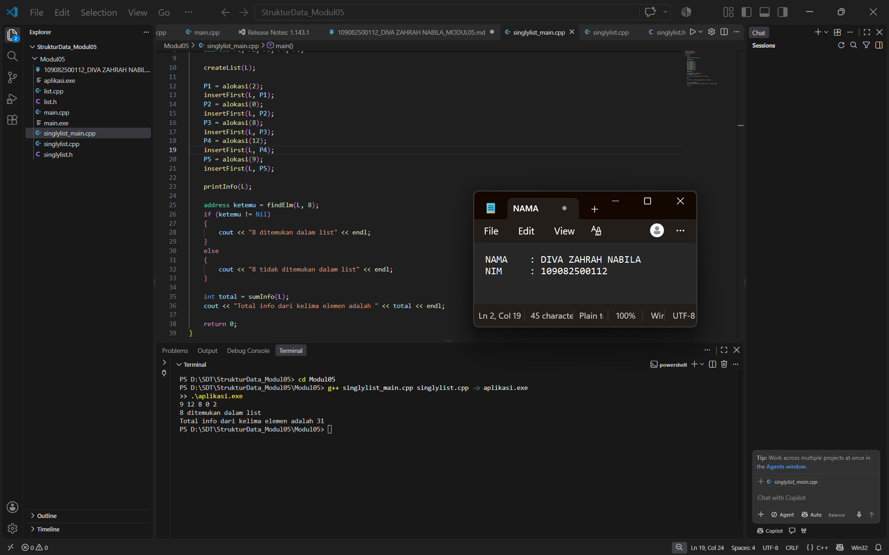

# <h1 align="center">Laporan Praktikum Modul 5 - SINGLY LINKED LIST (BAGIAN KEDUA)- ... </h1>
<p align="center">[Diva Zahrah Nabila] - [109082500112]</p>

## Unguided 

# Dasar Teori
## A.	Pencarian (Searching) pada Singly Linked List
###    Searching pada Singly Linked List adalah proses melintasi (traversal) setiap simpul (node) mulai dari elemen pertama (First) hingga menemukan elemen dengan nilai (info) yang dicari atau sampai mencapai ujung list (Nil / NULL). Karena Singly Linked List hanya memiliki satu arah pointer (next), pencarian dilakukan secara sekuensial (berurutan dari depan ke belakang)

## B.	Pengolahan dan Akumulasi Elemen List
###     Selain pencarian, elemen-elemen pada Linked List dapat diolah untuk operasi aritmatika seperti menghitung total nilai (sum) atau menghitung jumlah node (nbList). Proses ini dilakukan dengan menggunakan penunjuk sementara (traversal pointer) yang bergerak dari node awal hingga akhir sambil menjumlahkan nilai info pada setiap elemen.


##      Pemrograman Modular ADT
###     Untuk menjaga kerapian dan kemudahan perawatan kode, ADT Singly Linked List dibagi menjadi tiga berkas:  
###     Singlylist.h: Tempat deklarasi tipe data (struct), konstanta, dan spesifikasi prototipe fungsi/prosedur.   
###     Singlylist.cpp: Tempat menuliskan logika atau realisasi kode dari fungsi/prosedur yang ada pada header.   
###     main.cpp: Program utama (driver) untuk menjalankan fungsi-fungsi ADT dan berinteraksi dengan pengguna.


# GUIDED 1
### list.h: 

```cpp
#ifndef List_h
#define List_h
#define Nil NULL

#include <iostream>
using namespace std;

struct mahasiswa
{
    string nama, nim;
    int umur;
};

typedef mahasiswa dataMahasiswa;
typedef struct node *address;

struct node
{
    dataMahasiswa isidata;
    address next;
};

struct linkedList
{
    address first;
};

bool isEmpty(linkedList List);
void createList(linkedList &List);
address alokasi(string nama, string nim, int umur);
void dealokasi(address &node);
void printList(linkedList List);
void insertFirst(linkedList &List, address nodeBaru);
void insertLast(linkedList &List, address nodeBaru);
void insertAfter(linkedList &List, address nodeBaru, address prev);
void delFirst(linkedList &List);
void delLast(linkedList &List);
void delAfter(linkedList &List, address nodeHapus, address nodePrev);
int nbList(linkedList List);
void deleteList(linkedList &List);

address FindNodebyData(linkedList List, string data);
void FindNodebyAddress(linkedList List, address node);
void FindNodeByRange(linkedList List, int nilaiAwal, int nilaiAkhir);

void updateFirst(linkedList &list);
void updateLast(linkedList &list);
void updateAfter(linkedList &list, address &prev);
void updateByNim(linkedList &list, string nim);

#endif
``` 

### Penjelasan: file ini berfungsi sebagai header yang mendefinisikan struktur data Singly Linked List. Di dalamnya terdapat struktur mahasiswa untuk menampung atribut nama, NIM, dan umur, serta struktur node yang menyimpan data mahasiswa beserta pointer next. Berkas ini juga memuat deklarasi prototipe untuk seluruh operasi primitif seperti pembuatan list, alokasi/dealokasi memori, penambahan node (insert), penghapusan (delete), pengubahan data (update), dan pencarian (searching).


### list.cpp
```cpp
#include "list.h"
#include <iostream>
using namespace std;

// I.S = Initial State / kondisi awal
// F.S = Final State / kondisi akhir

// fungsi untuk cek apakah list kosong atau tidak
bool isEmpty(linkedList List)
{
    if (List.first == Nil)
    {
        return true;
    }
    else
    {
        return false;
    }
}

// pembuatan linked list kosong
void createList(linkedList &List)
{
    /* I.S. sembarang
       F.S. terbentuk list kosong */
    List.first = Nil;
}

// pembuatan node baru dengan menerapkan manajemen memori
address alokasi(string nama, string nim, int umur)
{
    /* I.S. sembarang
       F.S. mengembalikan alamat node baru dengan isidata = sesuai parameter dan next = Nil */
    address nodeBaru = new node;
    nodeBaru->isidata.nama = nama;
    nodeBaru->isidata.nim = nim;
    nodeBaru->isidata.umur = umur;
    nodeBaru->next = Nil;
    return nodeBaru;
}

// penghapusan node dengan menerapkan manajemen memori
void dealokasi(address &node)
{
    /* I.S. P terdefinisi
       F.S. memori yang digunakan node dikembalikan ke sistem */
    node->next = Nil;
    delete node;
}

// prosedur-prosedur untuk insert / menambahkan node baru kedalam list
void insertFirst(linkedList &List, address nodeBaru)
{
    /* I.S. sembarang, P sudah dialokasikan
       F.S. menempatkan elemen list (node) pada awal list */
    nodeBaru->next = List.first;
    List.first = nodeBaru;
}

void insertAfter(linkedList &List, address nodeBaru, address Prev)
{
    /* I.S. sembarang, nodeBaru dan Prev alamat salah satu elemen list (node)
       F.S. menempatkan elemen (node) sesudah elemen node Prev */
    if (Prev != Nil)
    {
        nodeBaru->next = Prev->next;
        Prev->next = nodeBaru;
    }
    else
    {
        cout << "Node sebelumnya tidak valid!" << endl;
    }
}

void insertLast(linkedList &List, address nodeBaru)
{
    /* I.S. sembarang, nodeBaru sudah dialokasikan
       F.S. menempatkan elemen nodeBaru pada akhir list */
    if (isEmpty(List))
    {
        List.first = nodeBaru;
    }
    else
    {
        address nodeBantu = List.first;
        while (nodeBantu->next != Nil)
        {
            nodeBantu = nodeBantu->next;
        }
        nodeBantu->next = nodeBaru;
    }
}

// prosedur-prosedur untuk delete / menghapus node yang ada didalam list
void delFirst(linkedList &List)
{
    /* I.S. list tidak kosong
    F.S. node pertama di list terhapus*/
    address nodeHapus;
    if (isEmpty(List) == false)
    {
        nodeHapus = List.first;
        List.first = List.first->next;
        nodeHapus->next = Nil;
        dealokasi(nodeHapus);
    }
    else
    {
        cout << "List kosong!" << endl;
    }
}

void delLast(linkedList &List)
{
    /* I.S. list tidak kosong
    F.S. node terakhir di list terhapus */
    address nodeHapus, nodePrev;
    if (isEmpty(List) == false)
    {
        nodeHapus = List.first;
        if (nodeHapus->next == Nil)
        {
            List.first->next = Nil;
            dealokasi(nodeHapus);
        }
        else
        {
            while (nodeHapus->next != Nil)
            {
                nodePrev = nodeHapus;
                nodeHapus = nodeHapus->next;
            }
            nodePrev->next = Nil;
            dealokasi(nodeHapus);
        }
    }
    else
    {
        cout << "list kosong" << endl;
    }
}

void delAfter(linkedList &List, address nodeHapus, address nodePrev)
{
    /* I.S. list tidak kosng, Prev alamat salah satu elemen list
    F.S. nodeBantu adalah alamat dari Prev→next, menghapus Prev→next dari list */
    if (isEmpty(List) == true)
    {
        cout << "List kosong!" << endl;
    }
    else
    { // jika list tidak kosong
        if (nodePrev != Nil && nodePrev->next != Nil)
        {
            nodeHapus = nodePrev->next;
            nodePrev->next = nodeHapus->next;
            nodeHapus->next = Nil;
            dealokasi(nodeHapus);
        }
        else
        {
            cout << "Node sebelumnya (prev) tidak valid!" << endl;
        }
    }
}

// prosedur untuk menampilkan isi list
void printList(linkedList List)
{
    /* I.S. list mungkin kosong
       F.S. jika list tidak kosong menampilkan semua info yang ada pada list */
    if (isEmpty(List))
    {
        cout << "List kosong." << endl;
    }
    else
    {
        address nodeBantu = List.first;
        while (nodeBantu != Nil)
        {
            cout << "Nama : " << nodeBantu->isidata.nama << ", NIM : " << nodeBantu->isidata.nim << ", Usia : " << nodeBantu->isidata.umur << endl;
            nodeBantu = nodeBantu->next;
        }
    }
}

// function untuk menampilkan jumlah node didalam list
int nbList(linkedList List)
{
    /* I.S. list sudah ada
       F.S. menampilkan jumlah node didalam list*/
    int count = 0;
    address nodeBantu = List.first;
    while (nodeBantu != Nil)
    {
        count++;
        nodeBantu = nodeBantu->next;
    }
    return count;
}

// prosedur untuk menghapus list (menghapus semua node didalam list)
void deleteList(linkedList &List)
{
    /* I.S. list sudah ada
       F.S. menghapus semua node didalam list*/
    address nodeBantu, nodeHapus;
    nodeBantu = List.first;
    while (nodeBantu != Nil)
    {
        nodeHapus = nodeBantu;
        nodeBantu = nodeBantu->next;
        dealokasi(nodeHapus);
    }
    List.first = Nil;
    cout << "List sudah terhapus!" << endl;
}

// prosedur-prosedur untuk melakukan update data node
void updateFirst(linkedList &list)
{
    dataMahasiswa newData;
    cout << "Masukan nama baru : ";
    cin >> newData.nama;
    cout << "Masukan nim baru : ";
    cin >> newData.nim;
    cout << "Masukan umur baru : ";
    cin >> newData.umur;
    list.first->isidata = newData;
}

void updateLast(linkedList &list)
{
    if (isEmpty(list))
    {
        cout << "List kosong!" << endl;
    }
    else
    {
        dataMahasiswa newData;
        cout << "Masukan nama baru : ";
        cin >> newData.nama;
        cout << "Masukan nim baru : ";
        cin >> newData.nim;
        cout << "Masukan umur baru : ";
        cin >> newData.umur;

        address nodeBantu = list.first;
        while (nodeBantu->next != Nil)
        {
            nodeBantu = nodeBantu->next;
        }

        nodeBantu->isidata = newData;
    }
}

void updateAfter(linkedList &list, address &prev)
{
    if (isEmpty(list))
    {
        cout << "List kosong!" << endl;
    }
    else
    {
        dataMahasiswa newData;
        cout << "Masukan nama baru : ";
        cin >> newData.nama;
        cout << "Masukan nim baru : ";
        cin >> newData.nim;
        cout << "Masukan umur baru : ";
        cin >> newData.umur;

        prev->next->isidata = newData;
    }
}

void updateByNim(linkedList &list, string nim)
{
    if (!isEmpty(list))
    {
        address nodeBantu = FindNodebyData(list, nim);

        if (nodeBantu != Nil)
        {
            dataMahasiswa newData;
            cout << "Masukan nama baru : ";
            cin >> newData.nama;
            cout << "Masukan nim baru : ";
            cin >> newData.nim;
            cout << "Masukan umur baru : ";
            cin >> newData.umur;

            nodeBantu->isidata = newData;
        }
    }
    else
    {
        cout << "List kosong!" << endl;
    }
}

// prosedur-prosedur untuk searching data didalam list
address FindNodebyData(linkedList List, string data)
{
    /* I.S. list mungkin kosong
       F.S. menampilkan node yang sesuai dengan nama atau nim yang dicari */
    if (isEmpty(List) == true)
    {
        cout << "List kosong!" << endl;
    }
    else
    {
        address nodeBantu = List.first;
        int posisi = 0;
        bool found = false;
        while (nodeBantu != Nil)
        {
            posisi++;
            if (nodeBantu->isidata.nama == data || nodeBantu->isidata.nim == data)
            {
                cout << "Data " << data << " ditemukan pada posisi ke-" << posisi << "!" << endl;
                cout << "Nama : " << nodeBantu->isidata.nama << ", NIM : " << nodeBantu->isidata.nim << ", Usia : " << nodeBantu->isidata.umur << endl;
                found = true;
                break;
            }
            nodeBantu = nodeBantu->next;
        }
        if (found == false)
        {
            cout << "Node dengan data " << data << " tidak ditemukan!" << endl;
        }
    }
    cout << endl;
    return Nil;
}

void FindNodebyAddress(linkedList List, address node)
{
    /* I.S. list mungkin kosong
       F.S. menampilkan node yang sesuai dengan alamat yang dicari */
    if (isEmpty(List) == true)
    {
        cout << "List kosong!" << endl;
    }
    else
    {
        address nodeBantu = List.first;
        int posisi = 0;
        bool found = false;
        while (nodeBantu != Nil)
        {
            posisi++;
            if (nodeBantu == node)
            {
                cout << "Node ditemukan pada posisi ke-" << posisi << "!" << endl;
                cout << "Alamat Node : " << nodeBantu << endl;
                cout << "Nama : " << nodeBantu->isidata.nama << ", NIM : " << nodeBantu->isidata.nim << ", Usia : " << nodeBantu->isidata.umur << endl;
                found = true;
                break;
            }
            nodeBantu = nodeBantu->next;
        }
        if (found == false)
        {
            cout << "Node dengan alamat " << node << " tidak ditemukan dalam list!" << endl;
        }
    }
    cout << endl;
}

void FindNodeByRange(linkedList List, int nilaiAwal, int nilaiAkhir)
{
    /* I.S. list mungkin kosong
       F.S. menampilkan semua node yang memiliki umur di dalam rentang nilaiAwal sampai nilaiAkhir */
    if (isEmpty(List) == true)
    {
        cout << "List kosong!" << endl;
    }
    else
    {
        address nodeBantu = List.first;
        int posisi = 0;
        bool found = false;
        cout << "--- Data diatas usia " << nilaiAwal << " dan dibawah " << nilaiAkhir << " ---" << endl;
        while (nodeBantu != Nil)
        {
            posisi++;
            int umur = nodeBantu->isidata.umur;
            if (umur > nilaiAwal && umur < nilaiAkhir)
            {
                cout << "Data ditemukan pada posisi ke-" << posisi << " :" << endl;
                cout << "Nama : " << nodeBantu->isidata.nama << ", NIM : " << nodeBantu->isidata.nim << ", Usia : " << nodeBantu->isidata.umur << endl;
                found = true;
            }
            nodeBantu = nodeBantu->next;
        }
        if (found == false)
        {
            cout << "Tidak ada data node dalam range tersebut!" << endl;
        }
    }
    cout << endl;
}
```

### Penjelasan: file ini berisi realisasi logika (kode murni) dari seluruh fungsi dan prosedur yang telah dideklarasikan pada list.h. Logika yang diimplementasikan meliputi manajemen memori dinamis (new dan delete), pengaturan hubungan pointer saat menyisipkan atau menghapus simpul (di awal, akhir, maupun setelah simpul tertentu), fungsi pencarian data berdasarkan rentang usia atau kata kunci, serta pengubahan isi data mahasiswa di dalam list.


### main.cpp:
```cpp
#include <iostream>
#include "list.h"
using namespace std;

int main()
{
    linkedList List;
    address nodeA, nodeB, nodeC, nodeD, nodeE = Nil;
    createList(List);

    nodeA = alokasi("Dhimas", "2311102151", 20);
    nodeB = alokasi("Arvin", "2211110014", 21);
    nodeC = alokasi("Rizal", "2311110029", 20);
    nodeD = alokasi("Satrio", "2211102173", 21);
    nodeE = alokasi("Joshua", "2311102133", 21);

    insertFirst(List, nodeA);
    insertLast(List, nodeB);
    insertAfter(List, nodeC, nodeA);
    insertAfter(List, nodeD, nodeC);
    insertLast(List, nodeE);

    cout << "--- ISI LIST SETELAH DILAKUKAN INSERT ---" << endl;
    printList(List);
    cout << "jumlah node : " << nbList(List) << endl;
    cout << endl;

    // updateFirst(List);
    // cout << "--- ISI LIST SETELAH DILAKUKAN UPDATE FIRST ---" << endl;
    // printList(List);

    // updateLast(List);
    // cout << "--- ISI LIST SETELAH DILAKUKAN UPDATE LAST ---" << endl;
    // printList(List);

    updateAfter(List, nodeC);
    cout << "--- ISI LIST SETELAH DILAKUKAN UPDATE AFTER ---" << endl;
    printList(List);

    updateByNim(List, "2211110014");
    cout << "--- ISI LIST SETELAH DILAKUKAN UPDATE BY NIM ---" << endl;
    printList(List);

    return 0;
}
```
### Penjelasan: file ini bertindak sebagai program utama (driver) untuk menguji fungsi Singly Linked List. Program membuat list baru, mengalokasikan lima data mahasiswa (nodeA hingga nodeE), lalu menyisipkannya ke dalam list menggunakan kombinasi metode insertFirst, insertLast, dan insertAfter. Selanjutnya, program menguji prosedur pengubahan data (updateAfter dan updateByNim) serta menampilkan jumlah dan rincian data mahasiswa yang tersimpan ke layar terminal.


# Unguided
### 1. Singlylist.h
```cpp
#ifndef SINGLYLIST_H_INCLUDED
#define SINGLYLIST_H_INCLUDED

#include <iostream>
using namespace std;

#define Nil NULL

typedef int infotype;
typedef struct ElmList *address;

struct ElmList
{
    infotype info;
    address next;
};

struct List
{
    address First;
};

void createList(List &L);
address alokasi(infotype x);
void dealokasi(address &P);
void printInfo(List L);
void insertFirst(List &L, address P);

address findElm(List L, infotype x);
int sumInfo(List L);

#endif
```

### penjelasan 
[file ini bertindak sebagai antarmuka atau kerangka dasar (header) yang mendeklarasikan struktur data dari Singly Linked List. Di dalamnya, didefinisikan sebuah alias tipe data infotype bertipe int untuk menyimpan nilai angka, serta pointer address yang menunjuk ke struktur ElmList. Struktur ElmList itu sendiri merepresentasikan satu simpul (node) yang memiliki dua ruang: info untuk menyimpan data aktual, dan next untuk menyimpan alamat simpul berikutnya. Selain itu, terdapat struktur List yang berfungsi sebagai penunjuk ke simpul paling depan (First). Pada berkas ini pula, seluruh purwarupa (prototipe) fungsi dan prosedur didaftarkan, termasuk fungsi standar list dan dua fungsi tambahan khusus untuk menyelesaikan studi kasus latihan, yaitu findElm untuk fitur pencarian dan sumInfo untuk fitur kalkulasi total.]


### 2. Singlylist.cpp

```cpp
#include <iostream>
#include "Singlylist.h"
using namespace std;

void createList(List &L)
{
    L.First = Nil;
}

address alokasi(infotype x)
{
    address P = new ElmList;
    if (P != Nil)
    {
        P->info = x;
        P->next = Nil;
    }
    return P;
}

void dealokasi(address &P)
{
    delete P;
    P = Nil;
}

void printInfo(List L)
{
    address P = L.First;
    while (P != Nil)
    {
        cout << P->info << " ";
        P = P->next;
    }
    cout << endl;
}

void insertFirst(List &L, address P)
{
    if (P != Nil)
    {
        P->next = L.First;
        L.First = P;
    }
}

address findElm(List L, infotype x)
{
    address P = L.First;
    while (P != Nil)
    {
        if (P->info == x)
        {
            return P; 
        }
        P = P->next;
    }
    return Nil; 
}

int sumInfo(List L)
{
    int total = 0;
    address P = L.First;
    while (P != Nil)
    {
        total += P->info;
        P = P->next;
    }
    return total;
}
```


### penjelasan
[Berkas ini adalah tempat di mana logika dari semua fungsi dan prosedur direalisasikan (body).
Fungsi Dasar: Operasi alokasi digunakan untuk memesan memori secara dinamis menggunakan sintaks new, sedangkan dealokasi menghapus memori dengan delete. Prosedur insertFirst bekerja dengan prinsip LIFO (Last In First Out), di mana elemen baru (P) akan dikaitkan ke elemen pertama saat ini (P->next = L.First), lalu penunjuk utama list dipindah ke elemen baru tersebut (L.First = P).

Fungsi findElm (Pencarian): Logika pencarian dibangun menggunakan metode sequential search. Menggunakan bantuan pointer P yang dimulai dari L.First, program akan melakukan perulangan while (P != Nil). Di dalam perulangan, program mengecek kondisi if (P->info == x). Jika data cocok (dalam hal ini angka 8), fungsi langsung mengembalikan alamat memori simpul tersebut. Jika perulangan selesai dan data tidak ditemukan, fungsi mengembalikan nilai Nil.

Fungsi sumInfo (Akumulasi): Fungsi ini menggunakan pendekatan traversal (penelusuran). Variabel total diinisiasi dengan nilai 0. Kemudian, pointer P bergerak dari satu simpul ke simpul lainnya. Di setiap pemberhentiannya, nilai P->info ditambahkan ke dalam variabel total (total += P->info). Setelah mencapai akhir list (Nil), fungsi mengembalikan nilai akhir dari total tersebut.]


### 3. Singlylist main.cpp

```cpp
#include <iostream>
#include "Singlylist.h"
using namespace std;

int main()
{
    List L;
    address P1, P2, P3, P4, P5;

    createList(L);

    P1 = alokasi(2);
    insertFirst(L, P1);
    P2 = alokasi(0);
    insertFirst(L, P2);
    P3 = alokasi(8);
    insertFirst(L, P3);
    P4 = alokasi(12);
    insertFirst(L, P4);
    P5 = alokasi(9);
    insertFirst(L, P5);

    printInfo(L);

    address ketemu = findElm(L, 8);
    if (ketemu != Nil)
    {
        cout << "8 ditemukan dalam list" << endl;
    }
    else
    {
        cout << "8 tidak ditemukan dalam list" << endl;
    }

    int total = sumInfo(L);
    cout << "Total info dari kelima elemen adalah " << total << endl;

    return 0;
}
```
### Output :



### penjelasan
[Berkas ini merupakan program utama (driver) yang mengeksekusi semua logika yang telah dibuat.
Proses Penyisipan: Program membuat list kosong, lalu mengalokasikan lima buah data secara berurutan sesuai modul, yaitu 2, 0, 8, 12, dan 9. Karena penambahan dilakukan secara eksklusif menggunakan prosedur insertFirst (sisip depan), data yang dimasukkan paling akhir akan berada di posisi paling depan. Hal ini menghasilkan susunan list yang terbalik dari urutan inputnya, yaitu menjadi 9 12 8 0 2.

Proses Pencarian: Program memanggil fungsi findElm(L, 8). Karena angka 8 berada di tengah list (simpul ketiga), fungsi berhasil menangkap alamatnya dan tidak bernilai Nil, sehingga program mencetak kalimat "8 ditemukan dalam list" ke layar terminal.

Proses Perhitungan: Terakhir, program memanggil fungsi sumInfo(L) yang akan menelusuri kelima simpul tadi dan melakukan penjumlahan matematis (9 + 12 + 8 + 0 + 2). Hasil perhitungan tersebut disimpan dalam variabel total dan dicetak ke layar, menghasilkan angka 31.]


# Kesimpulan
[Kesimpulan dari praktikum ini adalah pentingnya pemahaman mengenai struktur data Singly Linked List yang diimplementasikan melalui konsep Abstract Data Type (ADT) secara modular. Dengan memecah program menjadi tiga berkas utama (berkas header, implementasi logika, dan main driver), pengelolaan kode menjadi jauh lebih terstruktur, rapi, dan mudah dikembangkan. Praktikum ini juga membuktikan fleksibilitas penggunaan pointer dan alokasi memori dinamis dalam melakukan berbagai operasi manipulasi data secara efisien—mulai dari penambahan (insert), penghapusan (delete), pengubahan (update), hingga penelusuran node untuk pencarian (searching) dan kalkulasi matematis—yang semuanya merupakan fondasi krusial dalam rekayasa perangkat lunak. ]


### Referensi
#### Modul pembelajaran


